<h2>TensorFlow-FlexUNet-Image-Segmentation-Retinal-Vein-Occlusion-Macular-Edema-OCT (2026/10/23)</h2>
Sarah T. Arai 
Software Laboratory antillia.com  
This is the first experiment of Image Segmentation for <b>Retinal Vein Occlusion Macular Edema (RVO-ME) Optical Coherence Tomography </b> based on 
our <a href="https://github.com/sarah-antillia/TensorFlow-FlexUNet-Image-Segmentation-Model">
TensorFlowFlexUNet</a>
 (<b>TensorFlow Flexible UNet Image Segmentation Model for Multiclass</b>), and   
<a href="https://www.kaggle.com/datasets/gaoweihao/rvo-me-dataset/data">
<b>RVO-ME dataset</b>
</a>  
<b>A Dual-Task OCT Dataset for Joint Segmentation and Detection of Macular Lesions</b>
  

<b>Actual Image Segmentation for RVO-ME-OCT Images of 570x380 pixels</b> 
As shown below, the inferred masks predicted by our segmentation model trained by the dataset appear  similar to the 
ground truth masks.
  
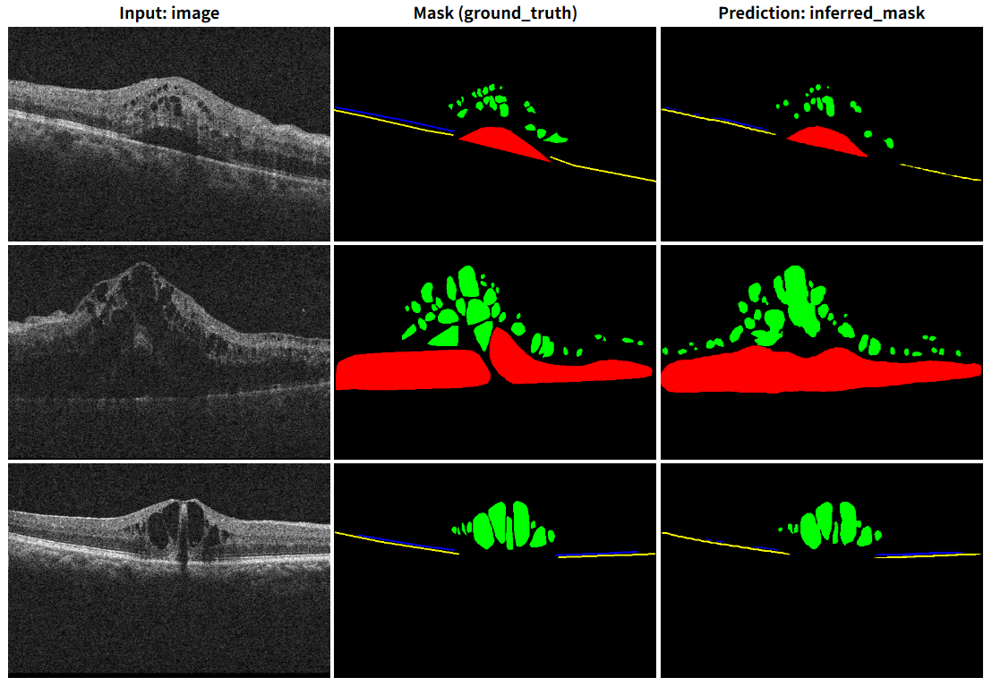
 
<!--
<table>
<tr>
<th>Input: image</th>
<th>Mask (ground_truth)</th>
<th>Prediction: inferred_mask</th>
</tr>
<tr>
<td></td>
<td></td>
<td></td>
</tr>

<tr>
<td></td>
<td></td>
<td></td>
</tr>

<tr>
<td></td>
<td></td>
<td></td>
</tr>
</table>
 -->

<b>Class_color_mapping_table</b> 
 
<table border=1 style='border-collapse:collapse;' cellpadding='5'>
<tr><th>Indexed Color</th><th>Color</th><th>RGB</th><th>Class</th></tr>
<tr><td>0</td><td with='80' height='auto'></td><td>(0, 0, 0)</td><td>Background</td></tr>
<tr><td>1</td><td with='80' height='auto'></td><td>(255, 0, 0)</td><td>SRF (Subretinal Fluid)</td></tr>
<tr><td>2</td><td with='80' height='auto'></td><td>(0, 255, 0)</td><td>IRF (Intraretinal Fluid)</td></tr>
<tr><td>3</td><td with='80' height='auto'></td><td>(0, 0, 255)</td><td>ELM (External Limiting Membrane)</td></tr>
<tr><td>4</td><td with='80' height='auto'></td><td>(255, 255, 0)</td><td>EZ (Ellipsoid Zone)</td></tr>
</table>

 
 
<h3>1. Dataset Citation</h3>
The image dataset used here was taken from   
<a href="https://www.kaggle.com/datasets/gaoweihao/rvo-me-dataset/data">
<b>RVO-ME dataset</b>
</a>  
<b>A Dual-Task OCT Dataset for Joint Segmentation and Detection of Macular Lesions</b>
  
The following explanation (excerpt) was taken from the website sbove.
  
<b>About Dataset</b> 
<b>RVO-ME: Retinal Vein Occlusion Macular Edema OCT Dataset</b> 
<b>Overview</b> 
RVO-ME is the first large-scale, dual-task dataset specifically designed for Retinal Vein Occlusion (RVO) analysis using Optical Coherence Tomography (OCT). RVO is the second most common vision-threatening retinal vascular disease globally, affecting approximately 28 million people worldwide, 
with macular edema (ME) being its primary complication causing vision loss.
  
This dataset provides 3,012 high-quality OCT B-scan images from 146 eyes of 130 patients, collected at The Second Affiliated Hospital of Nanchang University. Unlike general retinal datasets, RVO-ME offers fine-grained, manually annotated segmentation masks for critical pathological structures and point annotations for micro-lesions, filling a crucial gap in AI-driven ophthalmic research.
  
<b>Label Encoding (Mask Values):</b> 
0: Background 
1: SRF (Subretinal Fluid) — Hyporeflective dark area between retina and RPE 
2: IRF (Intraretinal Fluid) — Hyporeflective cystic spaces within retinal layers 
3: ELM (External Limiting Membrane) — 2-pixel wide line annotation 
4: EZ (Ellipsoid Zone) — 2-pixel wide line annotation (photoreceptor integrity marker) 
 
Note: ELM and EZ are annotated as 2-pixel-wide lines to preserve anatomical boundaries while minimizing overlap 
with adjacent layers.
  
<b>Citation Requirement</b> 
If you use this dataset in your research, competition submissions, or educational projects, 
you MUST cite the original paper:  
<pre>
BibTeX:
  @article{xiong2026rvo,
  title={RVO-ME: A Dual-Task OCT Dataset for Segmentation and Detection of Macular Lesions in Retinal Vein Occlusion},
  author={Xiong, Fen and Li, Guodong and Gao, Weihao and Gao, Yundi and Zhu, Yanfang and Xia, Xinjing and Ma, Lan and Liu, Weifeng and Hu, Yunwei},
  journal={Scientific Data},
  year={2026},
  publisher={Nature Publishing Group},
  doi={10.1038/s41597-026-06695-5}
}
</pre>
 
<b>License & Ethics</b> 
This dataset is released under Creative Commons Attribution-NonCommercial-NoDerivatives 4.0 International 
(CC BY-NC-ND 4.0).
  
Allowed: Academic research, educational use, Kaggle competitions, non-commercial algorithm development 
Prohibited: Commercial product training, redistribution of modified datasets, clinical deployment 
without institutional approval
  
Ethics Approval: Data collection was approved by the Ethics Committee of The Second Affiliated Hospital 
of Nanchang University (No. O-Medical Research Ethics [25]No.132). All patient identifiers have been removed 
in compliance with HIPAA and GDPR standards.
 
 
<h3>2 RVO-ME-OCT ImageMask Dataset</h3>
<h3>2.1 Download RVO-ME-OCT Dataset</h3>
 If you would like to train this RVO-ME-OCT Segmentation model,
 please download the original dataset from the Kaggle  
<a href="https://www.kaggle.com/datasets/gaoweihao/rvo-me-dataset/data">
<b>RVO-ME dataset</b>.</a> 
 
<pre>
./dataset
└─RVO-ME-OCT
    ├─test
    │   ├─images
    │   └─masks
    ├─train
    │   ├─images
    │   └─masks
    └─valid
        ├─images
        └─masks
</pre>
 
<b>RVO-ME-OCT Statistics</b> 
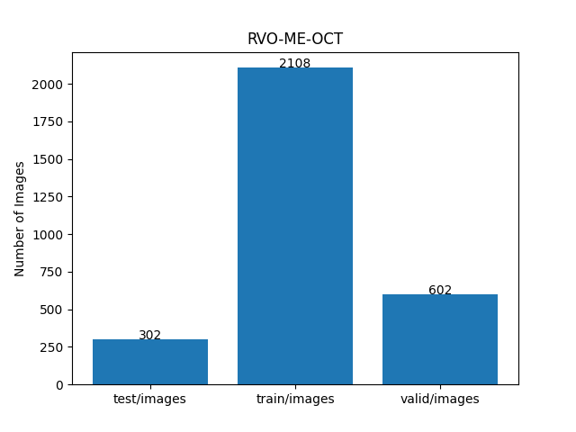 
  
As shown above, the number of images of train and valid datasets is large enough to use for the
 training set of our segmentation model.
  
<h4>2.2 Derivation of ImageMask Dataset</h4>
The folder structure of <b>RVO-Lesion</b> is as follows。 
<pre>
./RVO-Lesion
  ├─Image_Seg
  │  ├─images
  │  └─masks
  │  
  ├─RVO_HF_Detection
  └─RVO_Lesion_Labelme
      ├─1
..
</pre>
We generated a 570x380-pixel PNG <b>RVO-ME-OCT</b> dataset with colorized masks 
from JPG files in <b>images</b> subfolder and PNG files in <b>masks</b> subfolder in <b>Image_Seg</b> folder.
 
We also used 
<a href="#class_color_mapping_table"><b>Class_color_mapping table</b></a>
to create the colorized masks from the PNG in <b>masks</b>.
  
<h4>2.3 Train Sample Images and Masks</h4>
<b>Train sample images</b> 
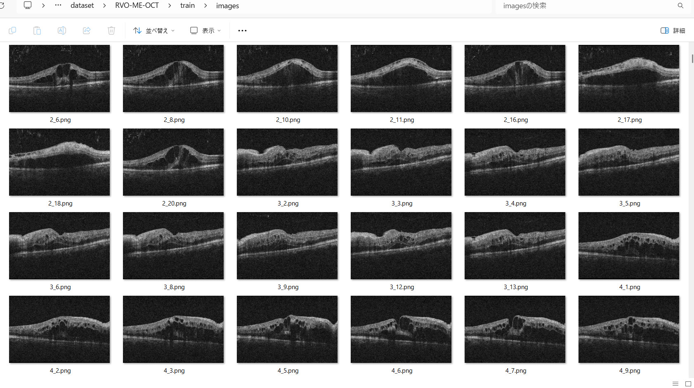
 
<b>Train sample masks</b> 
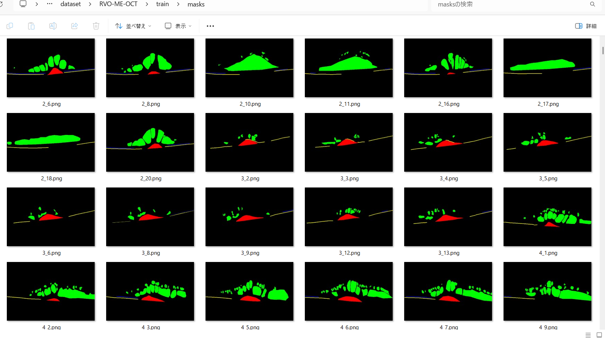
 
<h3>3 Train TensorFlowFlexUNet Model</h3>
 We trained RVO-ME-OCT TensorFlowFlexUNet Model by using the 
<a href="./projects/TensorFlowFlexUNet/RVO-ME-OCT/train_eval_infer.config"> <b>train_eval_infer.config</b></a> file.  
Please move to ./projects/TensorFlowFlexUNet/RVO-ME-OCT and run the following bat file. 
<pre>
>1.train.bat
</pre>
, which simply runs the following command. 
<pre>
>python ../../../src/TensorFlowFlexUNetTrainer.py ./train_eval_infer.config
</pre>

<b>Model parameters</b> 
Defined a small <b>base_filters = 16 </b> and large <b>base_kernels = (11,11)</b> for the first Conv Layer of Encoder Block of 
<a href="./src/TensorFlowFlexUNet.py">TensorFlowFlexUNet.py</a> 
and a large <b>num_layers = 8</b>(including a bridge between Encoder and Decoder Blocks).
<pre>
[model]
;You may specify your own UNet class derived from our TensorFlowFlexModel
model         = "TensorFlowFlexUNet"
image_width    = 512
image_height   = 512
image_channels = 3
input_normalize = True
normalization  = False
num_classes    = 4
base_filters   = 16
base_kernels   = (11,11)
num_layers     = 8
dropout_rate   = 0.05
dilation       = (1,1)
</pre>
<b>Learning rate</b> 
Defined a small learning rate.  
<pre>
[model]
learning_rate  = 0.00007
</pre>
<b>Loss and metrics functions</b> 
Specified "categorical_focal_dice_loss" and <a href="./src/dice_coef_multiclass.py">"dice_coef_hybrid"</a>. 
<pre>
[model]
loss           = "categorical_focal_dice_loss"
metrics        = ["dice_coef_hybrid"]
hybrid_alpha   = 1.6
hybrid_beta    = 0.4
</pre>
<b>Dataset class</b> 
Specified <a href="./src/ImageCategorizedMaskDataset.py">ImageCategorizedMaskDataset</a> class. 
<pre>
[dataset]
class_name    = "ImageCategorizedMaskDataset"
</pre>
 
<b>Learning rate reducer callback</b> 
Enabled learning_rate_reducer callback, and a small reducer_patience.
<pre> 
[train]
learning_rate_reducer = True
reducer_factor     = 0.5
reducer_patience   = 5
</pre>
<b>Early stopping callback</b> 
Enabled early stopping callback with patience parameter.
<pre>
[train]
patience      = 10
</pre>
<b>RGB Color map</b> 
Specified RGB color map dict for RVO-ME-OCT 1+3 classes. 
<pre>
[mask]
mask_datatype    = "categorized"
mask_file_format = ".png"
;RVO-ME-OCT RGB color map dict for 1+4 classes.
;                      SRF: red,   IRF: green,  ELM: blue,    EZ: yellow
rgb_map = {(0,0,0):0, (255,0,0):1, (0,255,0):2, (0,0,255):3, (255,255,0):4}
</pre>
<b>Epoch change inference callback</b> 
Enabled <a href="./src/EpochChangeInferencer.py">epoch_change_infer callback</a></b>. 
<pre>
[train]
epoch_change_infer       = True
epoch_change_infer_dir   =  "./epoch_change_infer"
num_infer_images         = 6
</pre>
By using this callback, on every epoch_change, the inference procedure can be called
 for 6 images in <b>mini_test</b> folder. This will help you confirm how the predicted mask changes 
 at each epoch during your training process.  
  
As shown below, early in the model training, the predicted masks from our FlexUNet segmentation model showed 
discouraging results. However, as training progressed through the epochs, the predictions gradually improved. 
   
<b>Epoch_change_inference output at starting (epoch 1,2,3)</b> 
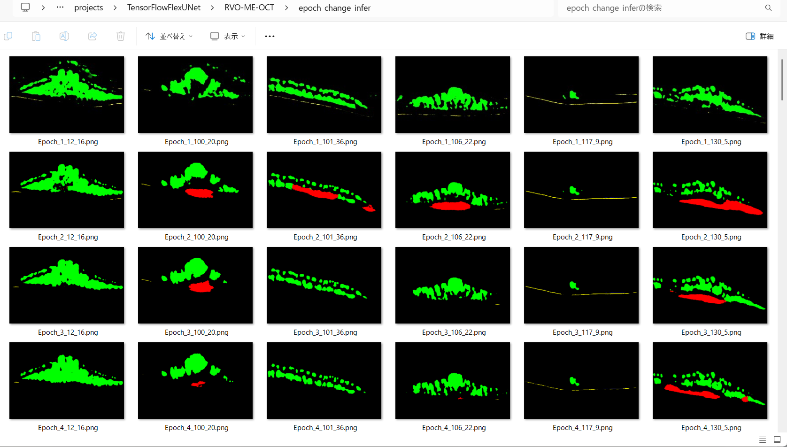 
 
<b>Epoch_change_inference output at middlepoint (epoch 15,16,17)</b> 
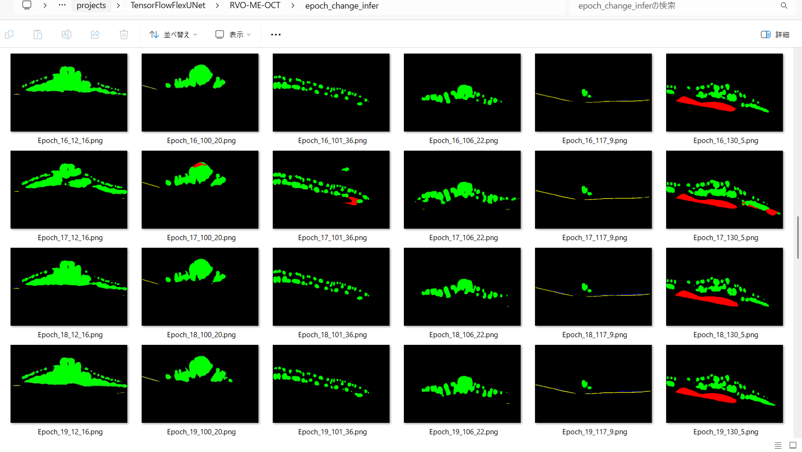 
 
<b>Epoch_change_inference output at ending (epoch 31,32,33)</b> 
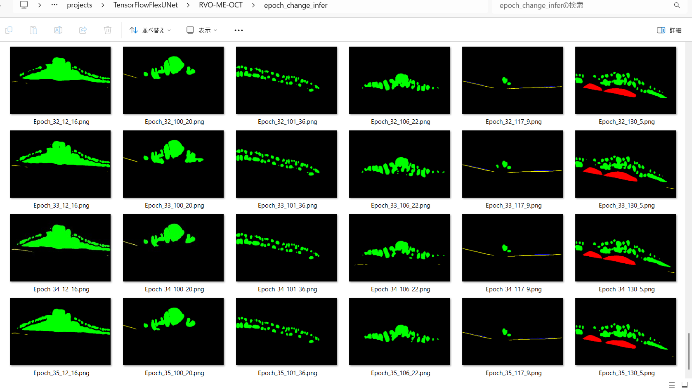 
 
In this experiment, the training process was terminated at epoch 33.  
 
 
<a href="./projects/TensorFlowFlexUNet/RVO-ME-OCT/eval/train_metrics.csv">train_metrics.csv</a> 
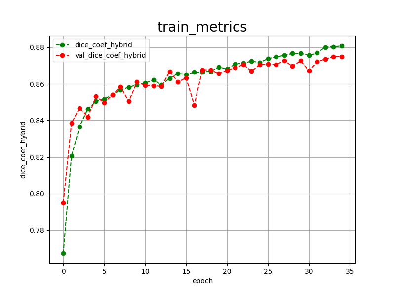 
 
<a href="./projects/TensorFlowFlexUNet/RVO-ME-OCT/eval/train_losses.csv">train_losses.csv</a> 
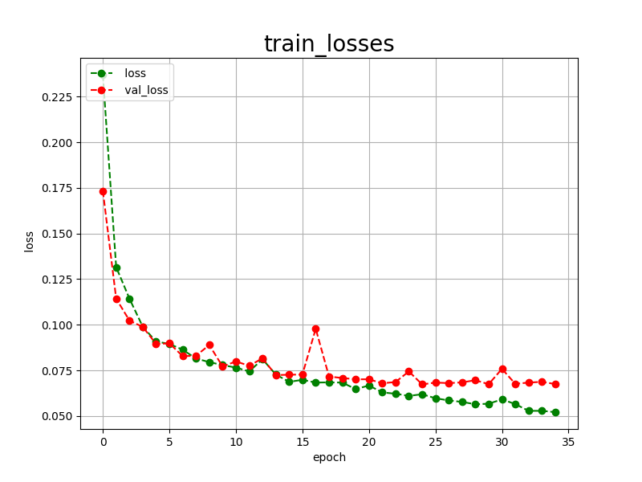
 
<h3>
4 Evaluation
</h3>
Please move to <b>./projects/TensorFlowFlexUNet/RVO-ME-OCT</b> folder, 
and run the following bat file to evaluate TensorFlowUNet model for RVO-ME-OCT. 
<pre>
>./2.evaluate.bat
</pre>
This bat file simply runs the following command.
<pre>
>python ../../../src/TensorFlowFlexUNetEvaluator.py ./train_eval_infer.config
</pre>
Evaluation console output: 
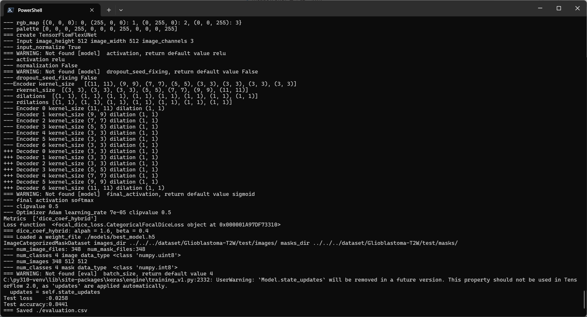
  Image-Segmentation-RVO-ME-OCT
<a href="./projects/TensorFlowFlexUNet/RVO-ME-OCT/evaluation.csv">evaluation.csv</a> 
The loss (categorical_focal_dice_loss) to this <b>RVO-ME-OCT/test</b> was not low, 
and  dice_coef_hybrid was not high as shown below.
 
<pre>
categorical_focal_dice_loss,0.0704
dice_coef_hybrid,0.8698
</pre>
 
<h3>
5 Inference
</h3>
Please move to a <b>./projects/TensorFlowFlexUNet/RVO-ME-OCT</b> folder, and run the following bat file to infer segmentation regions for images by the Trained-TensorFlowUNet model for RVO-ME-OCT. 
<pre>
>./3.infer.bat
</pre>
This simply runs the following command.
<pre>
>python ../../../src/TensorFlowFlexUNetInferencer.py ./train_eval_infer.config
</pre>

<b>mini_test_images</b> 
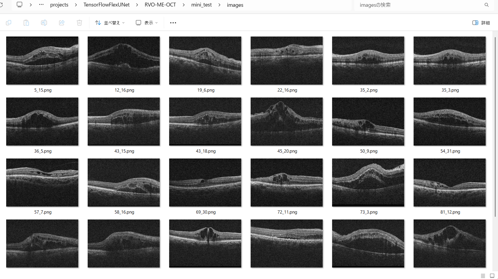 
<b>mini_test_mask(ground_truth)</b> 
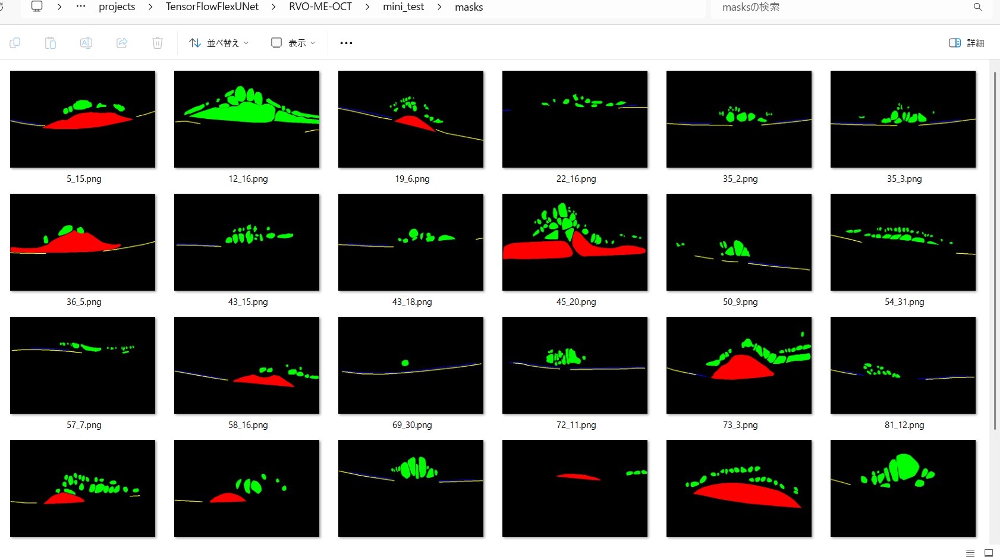 

<b>Inferred test masks</b> 
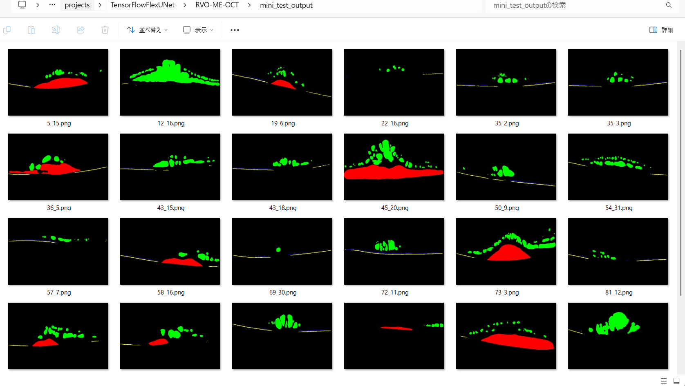 
 

<b>Enlarged images and masks of RVO-ME-OCT Images of 570x380 pixels</b> 
As shown below, the inferred masks predicted by our segmentation model trained by the dataset appear similar to the 
ground truth masks.
  
<a href="#class_color_mapping_table"><b>Class_color_mapping table</b>.</a>  
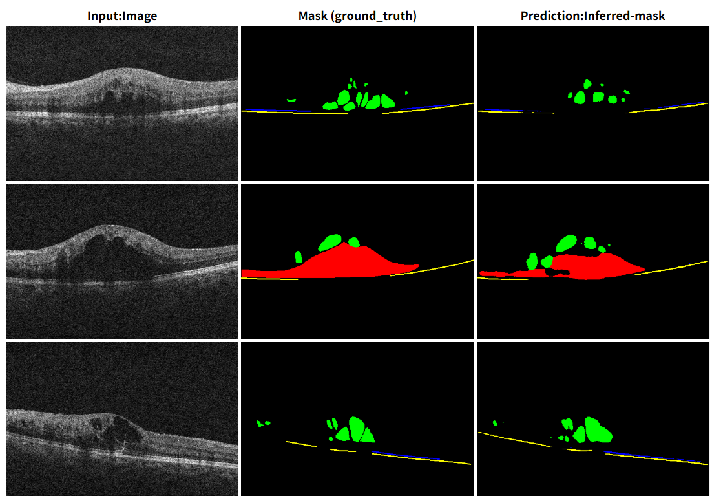 
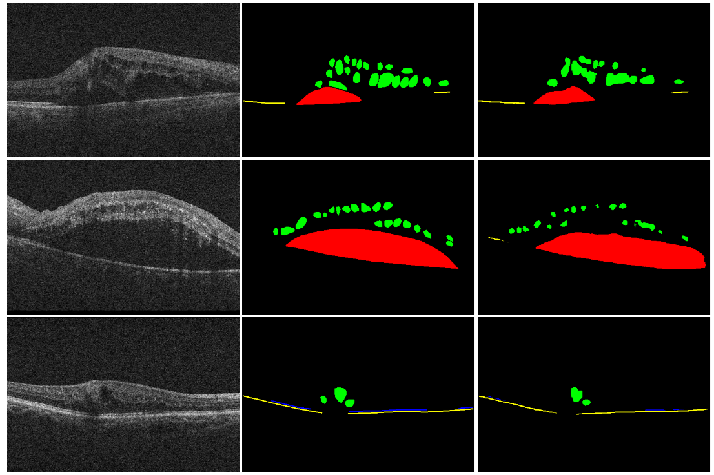

<!--
<table>
<tr>
<th>Input:Image</th>
<th>Mask (ground_truth)</th>
<th>Prediction:Inferred-mask</th>
</tr>
<tr>
<td></td>
<td></td>
<td></td>
</tr>

<tr>
<td></td>
<td></td>
<td></td>
</tr>

<tr>
<td></td>
<td></td>
<td></td>
</tr>

<tr>
<td></td>
<td></td>
<td></td>
</tr>

<tr>
<td></td>
<td></td>
<td></td>
</tr>

<tr>
<td></td>
<td></td>
<td></td>
</tr>
</table>
-->

 
<h3>
References
</h3>
<b>1. AMD-SD: An Optical Coherence Tomography Image Dataset for wet AMD Lesions Segmentation</b> 
Yunwei Hu, Yundi Gao, Weihao Gao, Wenbin Luo, Zhongyi Yang, Fen Xiong, Zidan Chen, 
Yucai Lin, Xinjing Xia, Xiaolong Yin, Yan Deng, Lan Ma & Guodong Li 
<a href="https://www.nature.com/articles/s41597-024-03844-6">
https://www.nature.com/articles/s41597-024-03844-6
</a>
  
<b>2. TensorFlow-FlexUNet-Image-Segmentation-Optical-Coherence-Tomography-AMD</b> 
Toshiyuki Arai  
<a href="https://github.com/sarah-antillia/TensorFlow-FlexUNet-Image-Segmentation-Optical-Coherence-Tomography-AMD">
https://github.com/sarah-antillia/TensorFlow-FlexUNet-Image-Segmentation-Optical-Coherence-Tomography-AMD</a>
  
<b>3. TensorFlow-FlexUNet-Image-Segmentation-Model</b> 
Toshiyuki Arai  
<a href="https://github.com/sarah-antillia/TensorFlow-FlexUNet-Image-Segmentation-Model">
https://github.com/sarah-antillia/TensorFlow-FlexUNet-Image-Segmentation-Model
</a>
 
 
